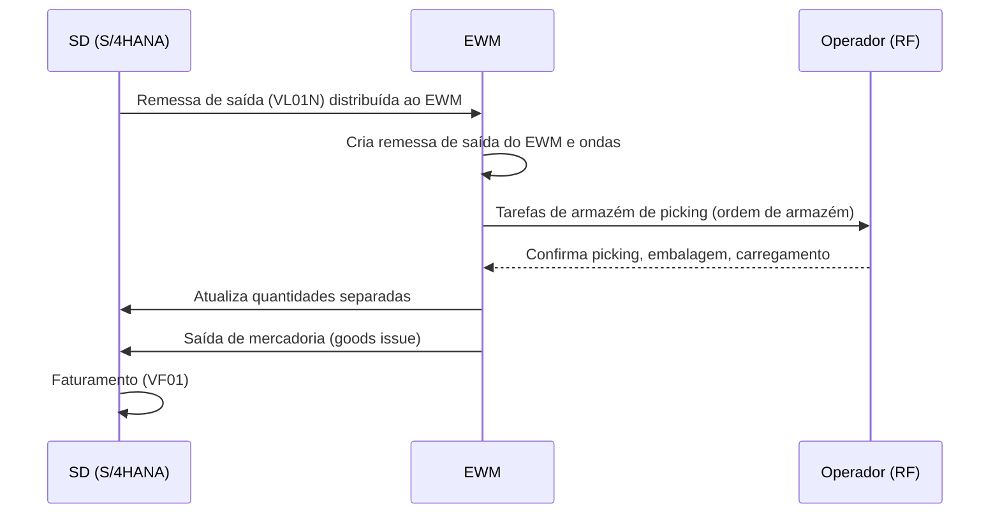

# SAP EWM - Study

> Nível: noção
> Extended Warehouse Management: embutido no S/4HANA ou descentralizado, tarefas de armazém, picking e a
> integração com a remessa do SD. Estudo de leitura, sem prática no trial. Relacionados:
> [SAP-WM-erp-study](https://github.com/igor-barral/SAP-WM-erp-study), [SAP-SD-erp-study](https://github.com/igor-barral/SAP-SD-erp-study),
> [SAP-MM-erp-study](https://github.com/igor-barral/SAP-MM-erp-study), [SAP-Order-to-Cash-erp-study](https://github.com/igor-barral/SAP-Order-to-Cash-erp-study),
> [SAP-S4HANA-erp-study](https://github.com/igor-barral/SAP-S4HANA-erp-study).

## Objetivo

O EWM é a solução de gestão de armazém da SAP para o S/4HANA, sucessora do WM clássico. Ele aparece em vagas de
logística e em projetos de migração que precisam substituir o WM. Este repositório é de noção: arquitetura,
vocabulário, onde o EWM entra no Order-to-Cash e o que o desenvolvedor encontra nele.

Ao concluir este estudo você deverá ser capaz de responder perguntas como:

- Quando o EWM embutido basta e quando ele roda separado?
- Onde o picking entra no Order-to-Cash?
- O que são tarefa de armazém e ordem de armazém?
- O que muda para o desenvolvedor em relação ao WM clássico?

## Ponte

Se o WM clássico parece um WMS "embutido" no ERP, o EWM está mais perto de um WMS completo: filas de trabalho,
ondas de separação, embalagem, unidades de manuseio, integração com automação e radiofrequência. Para quem já
integrou ERP com WMS de terceiros, o cenário descentralizado é familiar: dois sistemas trocando remessas e
confirmações.

## Conteúdo

### Modos de implantação

| Modo | Onde roda | Quando faz sentido |
|---|---|---|
| **Embedded EWM** | No mesmo sistema S/4HANA | Um ou poucos armazéns, integração simples com MM/SD, menor custo de operação |
| **Decentralized EWM** | Sistema separado (EWM sobre S/4HANA), integrado ao ERP | Armazéns de alto volume, necessidade de operar mesmo com o ERP indisponível, vários ERPs abastecendo o mesmo armazém |

Existe também a distinção comercial entre funções **básicas** e **avançadas** do EWM (a segunda com licença
própria). Confirme com o projeto quais recursos estão licenciados; não assuma.

### Objetos principais

| Objeto | Significado |
|---|---|
| Número de armazém (*warehouse number*) | O armazém controlado pelo EWM |
| Tipo de depósito, seção, posição (*storage bin*) | Estrutura física, semelhante ao WM |
| Remessa de entrada / saída do EWM | Cópia da remessa do ERP no EWM, com processamento próprio |
| Tarefa de armazém (*warehouse task*) | Movimentação a executar (o equivalente à ordem de transferência do WM) |
| Ordem de armazém (*warehouse order*) | Agrupamento de tarefas para um operador ou recurso |
| Onda (*wave*) | Agrupamento de itens de remessa liberados juntos para picking |
| Unidade de manuseio (*handling unit*) | Embalagem identificada (palete, caixa) |
| Tipo de processo de armazém | Regra que define como a tarefa é criada e executada |

Transações que aparecem no dia a dia (todas no namespace `/SCWM/`): `/SCWM/MON` (monitor de armazém),
`/SCWM/PRDO` (remessa de saída), `/SCWM/PRDI` (remessa de entrada). Confirme as demais no sistema; muitas
operações também têm apps Fiori.

### EWM no Order-to-Cash

No modo embutido, a comunicação é interna ao mesmo sistema; no descentralizado, passa por filas de RFC
(qRFC) entre ERP e EWM. Ver [SAP-RFC-integration-study](https://github.com/igor-barral/SAP-RFC-integration-study).

### O que muda para o desenvolvedor

- O EWM tem modelo de dados e *enhancement spots* próprios, diferentes do WM; código que lia `LTAK`/`LTAP` não
  tem equivalente direto e precisa ser redesenhado.
- Customizações costumam aparecer em relatórios de monitor, impressão de etiquetas e interfaces com automação.
- Ferramentas de radiofrequência (RF framework) permitem telas próprias para coletores.

## Respostas

**Quando o EWM embutido basta e quando ele roda separado?**
O embutido atende a maioria dos armazéns com integração direta ao S/4HANA e menor custo de manutenção. O
descentralizado é escolhido quando o armazém precisa de alta disponibilidade independente do ERP, tem volume
muito alto ou atende mais de um ERP.

**Onde o picking entra no Order-to-Cash?**
Depois da criação da remessa de saída e antes da saída de mercadoria. A remessa é distribuída ao EWM, que cria
tarefas de armazém de picking; a confirmação atualiza a remessa, e a saída de mercadoria libera o faturamento.

**O que são tarefa e ordem de armazém?**
A tarefa de armazém é uma movimentação (de uma posição para outra, com material e quantidade). A ordem de
armazém agrupa tarefas para execução por um operador ou recurso.

**O que muda em relação ao WM clássico?**
Modelo de dados, transações (`/SCWM/...`) e pontos de extensão são outros. O EWM traz ondas, unidades de
manuseio, filas de trabalho e integração com automação de forma nativa, e é a direção da SAP para o S/4HANA.

## Referências

- SAP Help Portal: https://help.sap.com (busque "Extended Warehouse Management" na documentação do SAP
  S/4HANA).
- SAP Learning: https://learning.sap.com (busque "Extended Warehouse Management").
- SAP Community: https://community.sap.com (busque "EWM").
